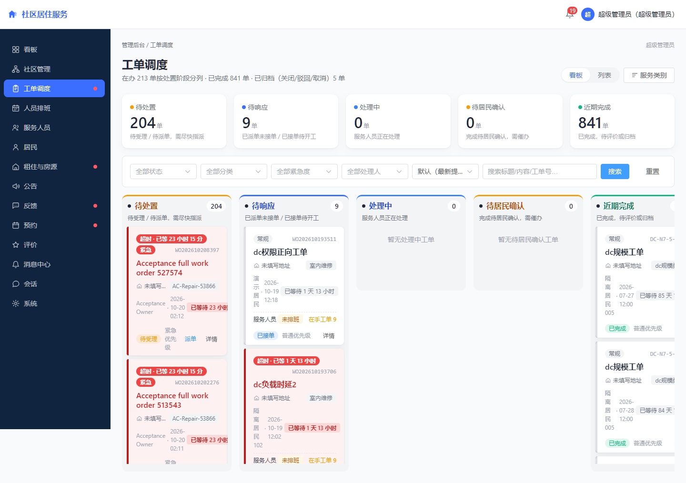
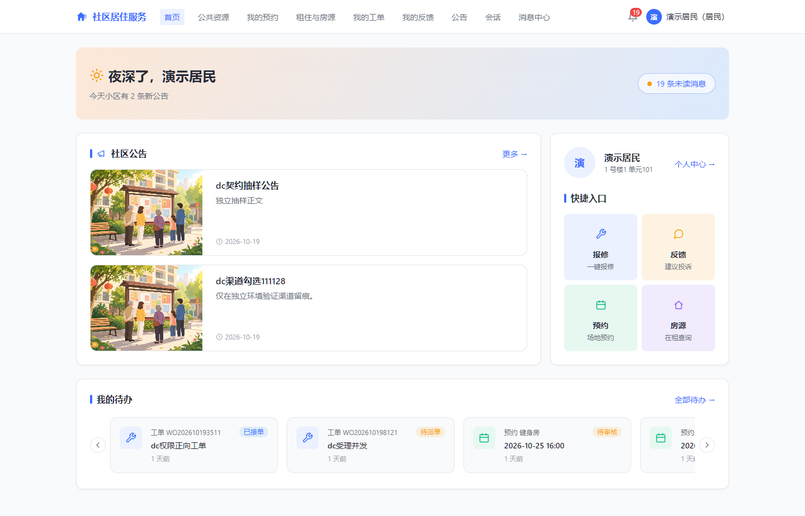
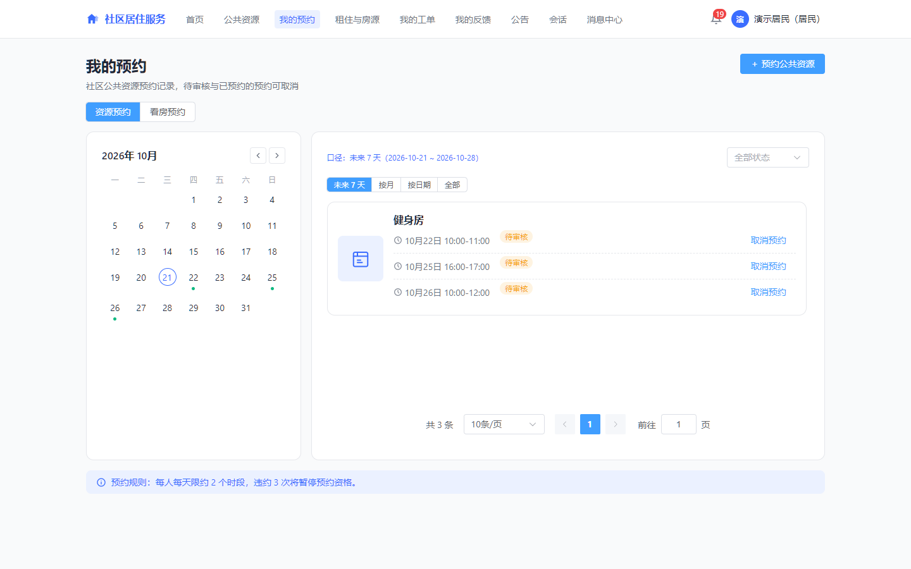

# 社区居住服务管理系统

面向小区管理人员、居民与服务人员的 Web 项目，把房屋与居住关系、报修工单、公告和公共资源预约放在同一套系统中。

**个人项目 · Spring Boot + Vue 3 · 有本地部署和验收记录**

本项目为个人实践项目，使用 AI 编码工具完成开发与迭代。验证基于演示/测试数据，不代表真实小区的生产运营。当前没有在线演示实例；原短期 ECS 已于 2026-10-22 释放。

[本地运行](#本地运行) · [验证证据](#验证范围) · [架构设计](docs/30_系统设计/架构设计.md) · [文档导航](#继续阅读)

## 界面与使用场景

### 管理员：按状态调度报修工单

将待分配、待响应、处理中、待确认和完成的工单放在同一看板，进入详情后分派人员与跟进处理。



### 居民：从首页查看公告与待办

公告、待处理工单、预约和房源入口集中展示；账号角色和有效居住关系共同决定可见内容。



### 居民：按日期查看资源预约

查看自己的公共资源预约和看房预约，按时间筛选，进入对应记录处理。



以上均为 2026-10-21 验收环境的真实应用截图，页面含合成测试数据；来源与版本说明见 [截图索引](docs/assets/showcase/README.md)。

## 一条完整的报修流程

1. 居民选择服务类别，提交报修内容与附件。
2. 管理员受理工单、分配服务人员。
3. 服务人员接单、记录处理过程和结果。
4. 居民确认处理结果并评价，管理端保留状态流转记录。
5. 参与者通过通知与会话查看进度；越权或不符合当前状态的操作被拒绝。

其他实现范围：小区与房屋管理、居住关系、租住管理、公告与反馈、公共资源预约、服务评价、运营统计、用户权限、消息通知、房源展示与看房预约。

出租流程包含入住申请、协议确认、首期成功后生效、缴租、租期延长和退租；出售场景仅覆盖房源展示与看房预约。支付渠道须自行配置，其可用性以对应验证记录为准。详见 [系统定义](docs/10_系统定义/系统定义.md)。

## 可以从代码中查看的三个重点

| 重点 | 实现与边界 | 入口 |
|---|---|---|
| 角色与数据范围 | 居民、服务人员、小区管理员、超级管理员四类账号；未登录是访问状态，小区范围与居住关系用于数据授权 | [DataScopeInterceptor](backend/src/main/java/com/community/residence/common/security/interceptor/DataScopeInterceptor.java) |
| 状态与并发一致性 | 工单、租住等流程按状态与业务规则约束操作；事务、锁与受影响入口有定向回归记录 | [锁与事务并发复核矩阵](docs/50_系统测试/锁与事务并发复核矩阵.md) |
| Redis 与查询验证 | 缓存降级、Redis 故障和状态竞态分别记录；性能数据仅对应列出的查询负载 | [并发与 Redis 故障复核](docs/50_系统测试/40_并发与Redis故障复核.md) |

技术栈：后端 Java 17、Spring Boot、MyBatis-Plus、MySQL、Redis/Redisson、Flyway；前端 Vue 3、TypeScript、Vite。采用前后端分离的单体结构。

## 本地运行

前提：JDK 17、Node.js（按前端 package.json 的 engines 要求）、Docker Desktop/Linux containers 和 Compose v2。以下为 Windows PowerShell，在新克隆的源码目录执行。


```powershell
git clone https://github.com/wssuifeng/community-residence-service-platform.git
cd community-residence-service-platform
```

1. 复制配置模板，填写本地测试密码和至少 32 字符的随机 JWT 密钥：


```powershell
Copy-Item .env.docker.example .env.docker
# 编辑 .env.docker 中的 MYSQL_APP_PASSWORD、MYSQL_ROOT_PASSWORD、JWT_SECRET
```

2. 构建后端与前端；本地 Compose 使用构建后的 JAR 与 dist：


```powershell
# JAVA_HOME 指向本机 JDK 17
Push-Location backend
.\mvnw.cmd -B -DskipTests package
Pop-Location
Push-Location frontend
npm ci
npm run build
Pop-Location
```

3. 启动四个服务：


```powershell
docker compose --env-file .env.docker -f docker-compose.local.yml config --quiet
docker compose --env-file .env.docker -f docker-compose.local.yml up -d --build --wait
```

4. 打开默认前端 `http://localhost:8088`，后端接口文档为 `http://localhost:8080/swagger-ui.html`。首次启动执行 Flyway 建表与种子初始化；演示账号、初始数据和图片说明见 [演示环境使用说明](docs/70_部署运行/演示环境使用说明.md)。登录后能查看页面、创建演示工单并流转，才算完成本地业务验证。

端口冲突时修改本地环境文件，勿把其他机器的端口快照当默认值。完整配置、日志与停止步骤见 [本地容器化部署](docs/70_部署运行/本地容器化部署.md)。未配置真实支付渠道时，不以登录或打包成功推断支付链路可用。

## 验证范围

以下是**既有报告**，本轮（2026-11-10）只复核来源、原始数据与展示链接，没有重新执行这些业务测试或压测。

| 日期与范围 | 已有结果 | 证据 |
|---|---|---|
| 2026-09-15 查询压测 | 50 并发，60s ramp-up / 600s 稳态 / 500ms pacing；共 54,950 个样本（含 200 次 setUp 登录）；整体 P95 36ms、P99 46ms；失败 1 次，约 0.002% | [原始 JTL](docs/50_系统测试/scripts/nf_steady_r5.jtl)、[执行记录 §6.3](docs/50_系统测试/07_测试执行记录.md) |
| 2026-10-22 后端回归 | 全量运行 1254 项，失败 0、错误 0、跳过 1；条件 MySQL 用例随后定向 1/1 通过 | [部署中控](docs/70_部署运行/_中控.md)、[补跑记录](docs/70_部署运行/定向MySQL集成测试验证记录-20261022.md) |
| 2026-10-22 前端回归 | 447 项通过，类型检查与生产构建通过 | [部署中控](docs/70_部署运行/_中控.md) |
| 2026-10-21 需求验收 | 75 项功能需求、13 条端到端流程验收记录；非功能项的接受条件见报告 | [评估验收报告](docs/60_评估验收/评估验收报告.md) |

压测使用 JMeter 5.6.3 / JDK 17，在 Windows 测试环境和 N7 数据集上执行，代码基线为 07f216f。7 个查询接口是：小区列表、房屋列表、公告列表、工单列表、通知列表、工单详情、房源详情。工单详情有两个令牌取样变体，房源没有列表取样。唯一失败记录为压测机 BindException；上述延迟不能外推到写入、真实支付、生产容量或任意网络环境。

## 继续阅读

- [项目总控与已知限制](docs/00_总控.md)
- [架构设计](docs/30_系统设计/架构设计.md) / [数据库设计](docs/30_系统设计/数据库设计.md)
- [系统测试报告](docs/50_系统测试/09_测试评估与报告.md) / [部署记录](docs/70_部署运行/本地部署验证记录-20261021.md)
- [后续开发与提交约定](docs/90_全局/开发与提交约定.md)
- [旧首页与历史分支材料](docs/archive/repository-showcase-20261110/INDEX.md)

许可证维持仓库现状；本轮未新增或变更许可证。
