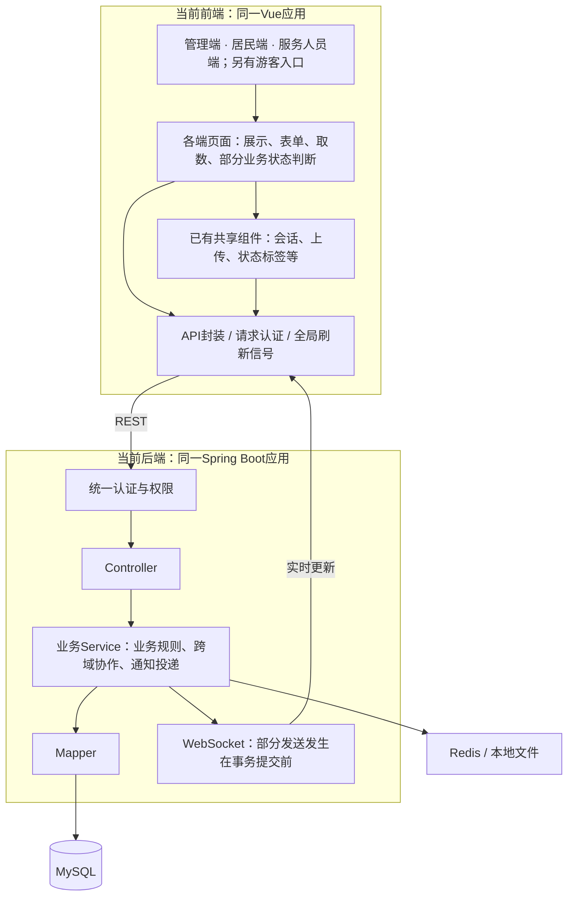
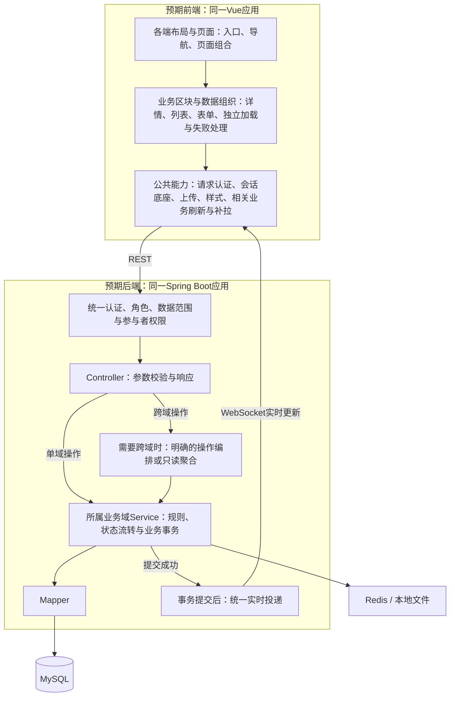

# 三端与公共模块架构评估

2026-10-18 · 源码基线 `f58282c` · 供用户审阅

本轮只评估。用户已确认三端会话基础功能手测通过；此处记录可维护性与结构优化建议，不撤销该结论，也不新增一轮全业务回归。尚未修改业务代码、数据库、接口或冻结的30设计。

采用 `codebase-design` 检查职责与复用，`vue-best-practices` 检查页面与数据组织，`redesign-existing-projects` 检查现有前端的一致性与维护成本。核查范围为三端路由/布局、公共请求与刷新、会话/通知、重点业务页面及后端跨域协作；不是逐行审计全部业务，也没有进行本轮浏览器视觉验收或性能实测。

## 0. 当前架构与预期架构

以下“当前”以本轮已核查源码为准；“预期”是建议达到的职责划分，尚未获实施授权，不代表已经改造。沿用已有前后端单体形态、技术栈、业务模型和权限规则。

### 0.1 当前架构

**整体形态：一个Vue应用承载三端和游客页面，一个Spring Boot应用承载所有业务域。** 前端通过REST办理业务，通过WebSocket接收通知与会话更新；后端用MyBatis-Plus访问MySQL，Redis承担缓存、锁及认证相关辅助数据，上传文件由现有本地文件服务管理。



当前已有分层，主要缺口是部分层的职责偏多，而非整套结构缺失：

- **三端页面：** 页面同时读取多类数据并拼出状态，工单详情在三端分别维护加载规则；居民租约页还依赖逐条支付记录判断入口。
- **共享前端：** 会话、上传等已经复用，但数据刷新主要依赖全局信号，部分导航、状态颜色和异常处理仍由页面分别维护。
- **后端业务域：** 社区、居民、租约、工单等已有清楚包结构；少数Controller直接组合多个域，社区删除集中依赖多个域的Mapper。
- **实时同步：** 通知与聊天仍保留各自业务模型和权限，但部分实时发送没有等待数据库事务提交。

### 0.2 预期架构

**整体仍为按业务域划分的单体，三端共享业务能力，分别组合自己的操作界面。** 前端负责输入和呈现，后端负责业务事实、权限、状态流转和金额等规则；跨域协作与页面所需摘要由明确入口组织。



图中的“操作编排”只用于真实跨域操作，“只读聚合”只用于页面需要的汇总读取，**不要求每个请求新增一层**。通知记录和会话消息仍在原业务事务中保存，提交成功后才发送实时更新；会话与消息中心仍保持各自已读规则、权限和数据。

| 部分 | 当前职责 | 预期职责 |
|---|---|---|
| 管理端 | 大页面同时维护结构、选区、编辑、详情及多域查询 | 页面组合结构目录、网格、详情和编辑区；各区块独立承担完整职责，管理动作保留原权限 |
| 居民端 | 页面组合租约、付款历史、协议与动作条件 | 页面展示后端摘要；按需读详情和历史；状态、金额、占用及居住关系以所属域规则为准 |
| 服务人员端 | 页面通过多次列表查询拼工作量与待办 | 页面读取同权限的工作台汇总，分别展示待办、工作量和通知；操作继续调用工单/看房原入口 |
| 前端公共模块 | 共享聊天等基础，同时部分加载、导航与状态规则仍分散 | 共享相同的数据组织与展示规则，刷新限定相关业务；各端保留不同动作与布局 |
| 后端业务模块 | 按域分包，但部分跨域调用、聚合和清理责任混杂 | 单域规则由所属域维护；跨域流程有明确协调者及事务顺序；不在公共目录复制业务规则 |
| 实时消息 | 业务事务内写记录并可能立即推送 | 业务事务内保存，提交后投递，失败按已有机制补拉；系统通知与会话沟通分开呈现 |

### 0.3 达到预期后的实际变化

- 三端工单详情共享主数据与辅助区的加载规则；修一次即可覆盖三端，受理、处理、评价等操作仍各自组合。
- 社区结构页拆分后，选区、批量修改和房屋详情分别可维护，原范围加载和编辑约束保留。
- 服务人员工作台从后端取汇总，减少前端多次读列表再拼统计。
- 居民租约列表取得必要摘要，进入详情再取历史，避免列表逐条拉取全部付款记录后重复判断。
- 一次业务变化只刷新相关内容；消息在提交成功后才实时通知客户端。

上述目标不要求拆微服务、按三端复制后端、增加消息队列、更换Vue/组件库或重建数据库。租约/支付相关查询与后端跨域清理风险较高，仍需独立设计审阅；本轮没有进入其实现或交易验证。

### 0.4 后端结构：端 → 业务模块 → 分层（用户明确层级）

用户进一步明确：`com.community.residence`下第一级为管理端、居民端、服务人员端、公共部分；第二级为具体业务模块；第三级为`controller/service/mapper`等分层。此结构取代上一版“新增顶层api包、只按端整理Controller”的目录草案。第一批仍只治理后端结构，前端和行为优化另列后续。

**目标：`admin/resident/staff/common → 具体模块 → controller/service/mapper/entity/dto/vo`。** 根启动类仍位于`com.community.residence`；四个分组是同一个后端工程里的Java包，继续单应用部署。

```text
com.community.residence
├── CommunityResidenceApplication.java
├── admin/                         # 管理端，含原超管专属能力
│   ├── community/
│   │   ├── controller/
│   │   ├── service/
│   │   ├── mapper/
│   │   ├── dto/
│   │   └── vo/
│   ├── workorder/
│   ├── resident/
│   ├── lease/
│   └── ...                        # 按实际管理模块建立
├── resident/                      # 居民端
│   ├── workorder/
│   │   ├── controller/
│   │   ├── service/
│   │   ├── mapper/
│   │   ├── dto/
│   │   └── vo/
│   ├── lease/
│   ├── reservation/
│   └── ...
├── staff/                         # 服务人员端
│   ├── workorder/
│   │   ├── controller/
│   │   ├── service/
│   │   ├── mapper/
│   │   ├── dto/
│   │   └── vo/
│   ├── housing/                   # 本端带看能力
│   └── ...
└── common/                        # 多端共用业务和技术支撑
    ├── workorder/
    │   ├── controller/            # 原多端共用契约，确有入口才创建
    │   ├── service/               # 共用工单规则与状态流转
    │   ├── mapper/                # 共用数据访问
    │   ├── entity/                # 同一业务实体唯一维护
    │   ├── dto/
    │   └── vo/
    ├── community/
    ├── resident/                  # 共用居民实体/居住关系规则
    ├── lease/
    ├── housing/
    ├── agreement/
    ├── payment/
    ├── auth/
    ├── conversation/
    ├── messaging/
    ├── web/                       # 统一响应、异常等
    ├── security/                  # 认证上下文、过滤器与权限支撑
    ├── upload/                    # 文件上传与存储
    ├── config/
    ├── log/
    ├── schedule/
    └── ...
```

以上为包组织原则与模块示例，不是完整类迁移表。业务模块按职责设分层；配置、过滤器等技术类按其实际用途放置，不为凑齐目录添加空Controller/Service/Mapper。实体以现有共享业务模型为准，各端可以保留专用DTO/VO，不复制同一数据库实体。

**各部分的职责：**

| 位置 | 负责什么 |
|---|---|
| `admin.<模块>` | 管理端入口、确有管理差异的操作组织和查询；社区管理员与超管仍保留原权限区分 |
| `resident.<模块>` | 居民入口、本人业务操作组织、居民专用查询与展示模型 |
| `staff.<模块>` | 服务人员入口、本人被派单/带看等操作组织及专用查询 |
| `common.<业务模块>` | 多端共用的规则、状态流转、持久化、实体及原多端共用接口；按具体业务分类 |
| `common.<技术模块>` | 安全、统一响应、文件、配置、日志、定时任务等支撑；不混入无归属的业务规则 |

**依赖方向与调用链：**

- 端内仍按`Controller → Service → Mapper`分层。端内Service可以使用所属公共业务Service完成共用操作；公共Service继续调用公共Mapper。端内Mapper用于确有差异的查询，原数据范围控制必须保留。
- 端内模块可依赖`common`；`admin/resident/staff`之间不直接调用，`common`不反向依赖任何端。Controller不直接访问Mapper。
- 同一工单状态机、租约生效、房屋占用和居住关系联动只保留一套公共规则；同一业务表的通用写入由公共业务模块负责，不在三端各实现一次。
- 第三级是允许放置各层的组织方式，不要求每个入口都额外增加一个只转发的Service或Mapper。没有端专属处理时，Controller直接使用对应公共Service；共享业务逻辑仍在Service层。

以工单为例：管理端派单、居民提交/确认、服务人员接单/处理分别归各端`workorder`模块；共用状态流转、实体、记录与通用数据访问归`common.workorder`。原详情、列表、时间线等多端共用契约可留在公共Controller，每个HTTP方法＋URL只对应一个处理方法，继续按身份筛选。Controller类带端名称，避免不同包下同名类的默认Bean名冲突。

首批迁移包括现有Controller、Service、Mapper、Entity/DTO/VO及技术类的包归属核定与必要的混合职责拆分，保持HTTP方法/URL/参数/响应/权限和业务行为兼容。迁移清单必须列出旧类/方法、新包、依赖、接口及权限，再同步包扫描、Mapper/SQL、切面、日志和测试引用。前端改版、数据库变更、支付/退款调用、刷新或投递行为调整均不随目录迁移混入。

**实施边界：** 本轮已按用户指定层级修正目标结构，尚未移动源码、修改冻结30或创建实现任务。后续先完成具体类归属和迁移批次，再按端与公共模块分批编译、启动映射核查及定向权限/业务测试，不要求用户重复整册手测。

## 1. 总体判断

**保留现有“按业务域划分的后端单体＋三端页面＋共享业务组件”，优先收拢重复的数据编排和刷新，再拆分职责混杂的页面。** 目前的主要负担不是部署形态，而是同一规则在多页维护、页面负责过多查询/判断，以及跨域操作的集中程度不一致。

值得保留的基础：

- 后端沿C1～C12及其域扩展组织，没有按三端复制业务服务的必要；权限继续由后端角色、数据范围和参与者规则共同控制。
- 会话已经共享 `ConversationWorkspace`、`useChatChannel`、消息列表与输入组件，反馈等来源通过适配接入；不需要再建一套群聊底座。
- 路由已有懒加载，构建已有依赖分包；社区结构已按选中范围读房屋并限制并发；刷新已有合并请求、可见性和身份隔离处理。
- `LeaseService.applyTransition`、租期计算、居住关系依赖与挂牌占用规则已有公共实现，应继续保持规则集中。

静态规模为144个Vue文件、93个非测试TS文件、464个后端生产Java文件。管理/居民/服务人员视图目录分别有62/28/7个Vue文件，含布局、弹窗和子组件，**不等于功能页面数**。行数只帮助定位复核对象，不作为缺陷或性能结论。

## 2. 公共模块：最值得先优化的部分

### A1 · 三端工单详情应共享加载规则

**源码确认：** 服务人员端已将主详情与时间线、附件分开加载，辅助接口失败仍能显示主详情；管理端、居民端仍使用一个 `Promise.all`，全部成功后才设置主详情。修复已经在三端之间产生差异。

**建议：** 提取工单详情的数据组织，统一详情、时间线、附件各自的加载/失败/重试状态；共享只读信息和时间线展示。三端的受理、派单、处理、评价等动作仍由各端组合，避免做成一个充满角色判断的巨型页面。

**收益与风险：** 同类加载修复只做一次；影响工单详情读取，风险较低。后续仅验证三端工单详情与辅助接口失败场景。

附带风险：三端详情都在初始化时把 `route.params.id` 转成常量，主要依赖 `onMounted` 取数。如果同一路由组件被复用切换ID，存在旧内容继续显示的可能；本轮没有动态复现。建议共享加载时一并以当前ID作为查询条件，并阻止旧请求覆盖新对象。[1]

### A2 · 将全局刷新缩小到相关业务

**源码确认：** `request.ts` 对成功的非认证写请求统一增加全局 `dataRevision`，页面的 `useLiveRefresh` 都订阅这一信号；通知和管理待办也会触发失效。已读类操作同样属于写请求。会话列表刷新还会从第一页读到已加载的末页。

**建议：** 保留现有150ms合并、运行中等待、可见时刷新和30秒兜底；在此基础上让页面声明自己关心的业务/对象，变更只通知相关订阅者。已读优先更新对应摘要和计数，服务端结果继续作为权威来源。会话列表保留当前位置，避免每次无关操作都重读已加载的所有页。

**收益与风险：** 缩小无关请求和页面闪动的影响范围，减少多页同步维护。当前只能证明广播范围宽，**不能据此宣称已发生请求风暴或测得性能下降**。调整需验证相应业务仍能收到刷新、切换账号无串数据；不建议此时引入新的全局查询框架。

### A3 · 统一事务提交后的实时投递

**源码确认：** `NotificationService.create` 插入通知及渠道留痕后直接调用WebSocket；`ConversationService` 的事务方法调用 `pushMessage`；反馈办结也在事务方法返回前推送。通知包说明写了 `AFTER_COMMIT`，实现却没有对应的提交后约束。

**风险推导：** 如果外层事务随后回滚，客户端可能先收到未落库的消息；如果收到事件立即补读，也可能早于提交。这是时序风险，不是本轮复现的现场故障。

**建议：** 记录仍随原业务事务落库，把实时投递集中到提交成功后执行，发送失败保留现有补拉兜底。Spring已有事务事件机制可用于该约束。[2] 提交后执行不自动等于异步，也不自动保证可靠送达；本轮没有证据要求引入消息队列或额外投递表。

**收益与风险：** 统一通知、会话、反馈的投递时机。涉及事务与身份空间，实施风险中等，应单独提交；验证提交、回滚、外层事务回滚和断线补拉，不通过实际付款制造场景。

## 3. 按三端收敛页面职责

| 编号 / 范围 | 目前的具体负担 | 建议的分工 | 收益 / 风险 |
|---|---|---|---|
| A4 管理端·社区结构 | `StructureTreePane.vue`约4,177行，混合结构加载、网格选择/缩放/右键、房屋详情、相册、居民及批量修改 | 页面只协调当前社区和选区；结构目录/范围查询、房屋网格、详情、批量操作分别承担完整职责，复用已有`structureData`、`structureBatch`与选区逻辑 | 修改选区或表单时不必同时理解整页；风险中等，必须保留范围加载、有限并发、“未勾选不修改”与单栋楼层边界 |
| A5 服务人员端·工作台 | `loadDashboard`用5个工单列表请求拼待办与统计，再独立取通知和工作量；初始涉及7个读取请求。当前仅挂载加载，未接入公共可见刷新 | 工单域提供同一权限范围内的工作台汇总读取；页面组合工作量、待办和通知区块，按相关业务刷新 | 减少前端拼统计和重复请求；风险中等，必须保留“当前负荷/派入次数”的既定口径，不凭前端重算历史 |
| A6 居民端·租约 | `LeaseListView.vue`约2,119行；列表后逐条查支付记录，10条时为1个列表＋最多10个记录请求，页面再推导付款入口 | 列表读取返回必要的租约/付款摘要；历史记录按需加载；页面分为租约列表、只读详情和业务动作编排，付款及合同状态依据后端事实展示 | 减少多请求和规则漂移；风险高于纯拆UI，牵涉状态/金额展示，宜后置并单独审查，不能顺手改支付流程 |

这三项均以减少调用方必须理解的业务复杂度为目标，不按固定行数机械拆文件，也不新增只负责转发的空接口。居民端与管理端的公共资源预约、房源筛选等重复表单可沿此原则后续整理，但本轮没有足够证据把所有重复表单都列为必须重构。

## 4. 后端协作：保持业务域，明确跨域操作入口

### A7 · 收拢跨域编排及社区删除的协调职责

**源码确认：** 会话Controller直接组合看房校验和房源查询；社区Controller也依赖房源服务。现有30架构的文字约束禁止Controller跨模块调用，部分实现与该约束不一致。`CommunityService` 同时直接持有多个业务域的Mapper，并手动组织社区删除顺序，新增下游实体时需要持续补入同一处。

**建议：** 把“会话中预约看房”“社区房屋挂牌查询”等跨域操作放到明确的应用编排或只读聚合入口，Controller只负责协议适配。社区删除保留一个统一事务与固定协调入口，各域负责其数据清理约束；不能简单拆成独立提交或任意顺序的批量删除。具体名称、职责和调用方向在实施前单独设计。

**收益与风险：** 减少新增业务表时漏接清理、各入口重复鉴权与跨域链条难追踪。跨域读取本身不等于业务错误；本轮也没有用import互相引用推断Spring存在循环依赖。此项涉及数据完整性和权限，风险较高，应先写清调用与事务约束，后实施，不在本次评估中改冻结设计。

租约状态流转、房屋占用、主关系与同住关系联动继续走现有公共规则，不在各端重做。支付、协议和退款只做本轮静态观察，不运行任何交易命令或改动渠道配置。

## 5. 前端还有哪些值得调整

### A8 · 导航定义收口，不混同路由和菜单

`permission.ts`定义了按角色输出路由/菜单的Store，但全文检索未找到实际调用；管理侧栏、居民与服务人员顶部导航各自维护条目。建议先核清并清理未使用的抽象，把路由名称、角色、菜单归属和详情页选中规则建立明确对应。可以共享导航数据，不必强制三个端采用同一布局，也不把隐藏菜单当成后端授权。

收益是避免“会话/消息中心”等名称和选中规则再次分散修正。优先级低于数据可靠性；实施时只需核对三端入口、角色可见性与详情返回。

### A9 · 统一已有样式与状态表达，保持已确认布局

已有 `variables.css` 和 `StatusTag` 等基础，但新会话样式仍有大量独立颜色、间距值，工单状态到颜色的映射也在多个页面维护。建议逐步收拢相同含义的样式变量、状态标签、只读信息行、加载/失败/空列表/重试及操作区。业务特有的布局尺寸可以保留，不要求所有像素值都抽象。

本轮没有重新运行页面，不给未经观察的页面下视觉缺陷结论；已确认的首页容器、三端会话布局及本人消息姓名/时间顺序继续保留。后续若调整，仅检查对应页面在实际工作分辨率与窄屏下的占用、滚动和交互。

### A10 · 性能专项先量化，再决定是否增加机制

已有路由懒加载和依赖分包；Element Plus当前全局注册及CSS导入，只能说明可评估按需使用，不能直接断言它是瓶颈。房屋网格、聊天历史是否需要虚拟化，也应由可见DOM数量、脚本/布局耗时及实际长列表场景决定。[3]

另有长时使用观察项：聊天缓存限制会话数量，但单会话合并后的消息总量、阅读位置Map未设置明确容量上限。建议先测连续使用与多次加载历史，再决定淘汰策略；当前不认定为内存泄漏。此项优先级较低，不以新增重依赖作为默认方案。

## 6. 后续行为优化候选顺序与审阅边界

当前优先项为§0.4后端项目结构治理；下表是其后的行为/页面候选顺序，不与包结构迁移同时实施。

| 顺序 | 候选工作 | 实施前需要明确的内容 | 后续只验证什么 |
|---|---|---|---|
| 第一批 | A1工单详情公共加载、A2相关业务刷新；A3提交后投递单独处理 | 共享加载接口、失效范围、事务提交与身份空间约束；三个独立改动，不能打成一次大重构 | 三端工单详情/辅助失败、所影响业务的实时刷新、投递提交/回滚/断线补拉 |
| 第二批 | A4管理端结构拆分、A5服务工作台汇总；顺带A8/A9的直接相关部分 | 各区块输入输出、工作台统计来源；既有编辑/权限规则保持 | 社区结构相关操作和服务工作台；不重测其它已通过链 |
| 第三批 | A6居民租约查询组织、A7后端跨域协调 | 独立职责设计及接口兼容策略；明确涉及哪些状态/事务，交易相关部分保持单独边界 | 租约读取/展示、跨域鉴权与删除完整性；不自动扩大为真实交易测试 |
| 按证据追加 | A10性能和缓存优化，其余样式统一 | 先提供请求数、耗时、DOM与长时使用基准，再选择措施 | 被证明受影响的页面和性能指标 |

这些是候选建议，**尚未进入实施**。用户审阅后再将选中项收敛为具体设计、拆分与验证任务；不因此自动修改30/40已完成阶段包。50阶段继续按当前指针管理，架构建议不作为新一轮全业务手测的前置条件，也不自动改变阶段出口结论。

## 7. 关键代码依据与资料

下表只列足以复核主要结论的入口，完整静态统计与行号见[源码清单](evidence/cp-architecture-assessment-20261018/source-inventory.json)。[采集脚本](evidence/cp-architecture-assessment-20261018/collect_inventory.py)仅扫描源码并写证据文件，可从任意工作目录复跑；它不启动服务、不访问数据库或业务接口。

| 对应 | 可复核入口 |
|---|---|
| A1 | [管理工单详情](../../frontend/src/views/admin/workorder/WorkOrderDetailView.vue#L120)、[居民工单详情](../../frontend/src/views/resident/WorkOrderDetailView.vue#L134)、[服务人员工单详情](../../frontend/src/views/staff/WorkOrderDetailView.vue#L95) |
| A2 | [写请求统一失效](../../frontend/src/utils/request.ts#L44)、[公共刷新](../../frontend/src/composables/useLiveRefresh.ts#L5)、[会话列表分页刷新](../../frontend/src/composables/useConversationInbox.ts#L14) |
| A3 | [通知生成与发送](../../backend/src/main/java/com/community/residence/messaging/service/NotificationService.java#L73)、[会话投递](../../backend/src/main/java/com/community/residence/conversation/service/ConversationService.java#L752)、[反馈办结投递](../../backend/src/main/java/com/community/residence/feedback/service/FeedbackService.java#L112) |
| A4～A6 | [结构范围加载](../../frontend/src/views/admin/community/StructureTreePane.vue#L337)、[服务工作台](../../frontend/src/views/staff/DashboardView.vue#L156)、[居民租约加载](../../frontend/src/views/resident/LeaseListView.vue#L103) |
| A7 | [会话跨域入口](../../backend/src/main/java/com/community/residence/conversation/controller/ConversationController.java#L74)、[社区服务](../../backend/src/main/java/com/community/residence/community/service/CommunityService.java)、[租约流转内核](../../backend/src/main/java/com/community/residence/lease/service/LeaseService.java#L256) |
| A8～A10 | [权限Store](../../frontend/src/store/permission.ts#L14)、[管理导航](../../frontend/src/components/layout/AppSidebar.vue#L38)、[样式变量](../../frontend/src/styles/variables.css)、[聊天数据组织](../../frontend/src/composables/useChatChannel.ts) |

官方资料仅用于核对机制，不替代本项目源码证据：

1. Vue Router：[Reacting to Params Changes](https://router.vuejs.org/guide/essentials/dynamic-matching.html#reacting-to-params-changes)，相同组件匹配不同参数时会复用实例，应监听参数或使用路由更新钩子。
2. Spring Framework：[Transaction-bound Events](https://docs.spring.io/spring-framework/reference/data-access/transaction/event.html)，事务事件支持提交后处理；本轮未据此调整框架版本或实施代码。
3. Vue：[Performance](https://vuejs.org/guide/best-practices/performance)，先测量再优化，并说明代码拆分及大列表虚拟化的适用情形。
