# 基于 Spring Boot 的小区居住服务管理系统设计与实现

> 论文初稿 v1（2026-10-22）
> 格式依据：2027届本科毕业论文（设计）格式模版（标注版）
> 事实来源：docs/10_系统定义、20_需求分析、30_系统设计、40_开发实施、50_系统测试、70_部署运行

---

## 摘 要

针对小区管理方在房屋、居住关系、服务事项与公共资源管理中信息分散、流程不可追溯、预约易冲突的问题，本文设计并实现了一个基于 Spring Boot 的小区居住服务管理系统。系统采用前后端分离的单体架构，后端以 Spring Boot 提供 RESTful 接口，前端以 Vue 3 与 TypeScript 构建居民、服务人员与管理员三类入口，持久层采用 MySQL 与 MyBatis-Plus，并以 Redis 与 Redisson 承担缓存与分布式锁。系统面向四类角色实现小区与房屋层级管理、居民与居住关系管理、租住管理、工单、公告、反馈会话、公共资源预约、服务评价、运营统计、权限管理与消息通知等功能。设计上以功能权限与小区数据权限两层模型实现多小区数据隔离，以六类业务状态机约束流转，以时段唯一约束与分布式锁保证预约并发正确性，以长连接推送结合增量补拉保证通知不丢失。测试覆盖功能、权限、异常流程与非功能四类，越权访问与预约冲突用例全部被拦截，并完成容器化部署验证。结果表明该系统能够支撑单小区与多小区场景下的日常居住服务管理。

【关键词】小区管理；居住服务；Spring Boot；Vue 3；权限控制

---

## Abstract

To address the problems of scattered information, untraceable service processes and frequent reservation conflicts in the management of housing, residence relationships, service items and public resources, this thesis designs and implements a residential community residence service management system based on Spring Boot. The system adopts a front-end and back-end separated monolithic architecture. The back end provides RESTful interfaces with Spring Boot; the front end builds three entries for residents, service staff and administrators with Vue 3 and TypeScript; the persistence layer uses MySQL and MyBatis-Plus; and Redis with Redisson provides caching and distributed locks. Facing four roles, namely residents, service staff, community administrators and super administrators, the system implements community and housing hierarchy management, resident and residence relationship management, lease management, work orders, notices, feedback conversations, public resource reservation, service evaluation, operation statistics, permission management and message notification. A two-level permission model of functional permission and community-scoped data permission realizes multi-community data isolation; six business state machines constrain state transitions; time-slot unique constraints and distributed locks guarantee reservation concurrency correctness; long-connection push combined with incremental pull ensures that notifications are not lost. Tests cover functional, permission, exception-flow and non-functional categories; unauthorized access and reservation conflict cases are all intercepted, and containerized deployment verification is completed. The results show that the system can support daily residence service management in both single-community and multi-community scenarios.

【Key words】Community Management; Residence Service; Spring Boot; Vue 3; Access Control

---

## 目 录

（正文生成后由 Word 自动生成目录）

---

# 1 绪论

## 1.1 研究背景及意义

城市居住小区的类型多样，商品房小区、长租公寓、公共租赁住房以及单位与园区宿舍等，均由相应的物业企业、运营单位或后勤部门实施管理。不同类型小区的管理主体不同，但面临的问题高度相似：房屋、住户、入住与搬出、报修、公告和公共资源使用等信息，长期散落在纸质台账、电子表格、电话记录与即时通信群组之中。

这种分散记录方式带来四类直接后果。一是信息更新滞后，房屋实际居住状态与台账不一致，居住关系难以厘清；二是服务过程不可追溯，居民提交的报修事项在流转中缺少统一记录，出现争议时无法还原处理经过；三是公共资源预约缺乏冲突校验，同一活动室或停车位被重复占用后只能事后协调；四是服务质量缺少数据支撑，管理方难以量化考核服务人员的工作量与居民满意度。

从管理对象看，小区居住服务的核心并不是单一的业务流程，而是一组围绕"人—房—事"关系展开的业务集合：居民与房屋之间通过居住关系建立联系，居住关系的建立、变更与终止贯穿入住、租住、搬出全过程；服务事项则按性质分为需要派人处理的工单类事项与需要答复沟通的反馈类事项；公共资源与房源又构成面向居民和潜在租户的另一类服务入口。这些业务彼此关联，任何一处信息失真都会沿关系链传导。

从政策与行业要求看，住房租赁信息的真实性已被明确要求。《住房租赁条例》规定住房租赁企业、房地产经纪机构发布房源信息应当真实、准确、完整。对小区管理方而言，房源地址、面积、租金等信息若缺少统一维护入口，既难以满足真实性要求，也容易在多次转述中失真。

基于上述背景，本课题设计并实现一个面向小区管理者的小区居住服务管理系统。系统的实践意义体现在四个方面：将分散的小区管理信息集中化、结构化，通过入住审核、搬出登记和租期维护保证居住关系数据准确可查；将报修与隐患上报统一为工单流程，处理全程留痕，居民可实时查看进度，管理方可以量化考核服务质量；通过公共资源预约的时间冲突校验，把冲突从事后协调提前到提交时拦截；通过统计报表为管理方提供运营决策依据。

本课题的理论与训练意义在于完整实践软件工程的全流程：从需求分析、系统设计、数据库设计到前后端编码与系统测试，逐阶段形成可追溯的文档与产物，掌握 Spring Boot、Vue 3、MySQL、Redis 等主流开发技术，提高独立分析问题与解决问题的能力。

## 1.2 国内外研究现状

小区管理与物业服务信息化的研究与实践已积累较多成果，按研究对象可分为综合性小区（物业）管理系统与面向单一业务的专题系统两类。

综合性系统方面，张艳军等{c1}设计了小区居民信息管理平台，以"一模块一表加外键"的扁平结构组织小区、居民与业务数据，其优点是实现直接，但对居住关系随时间的状态变化缺少建模。闫俊甫等{c2}实现了基于前后端分离的小区物业管理系统，验证了该架构在物业场景下的可行性。杨玉等{c3}将 Spring Boot 与 Vue 结合用于物业管理系统，但其自述未实现支付、投诉与多级维修流程，说明综合性系统在业务深度上仍存在取舍。包添文{c4}的小区管理系统在分层架构与居民信息维护分离方面较为完整，但缴费环节采用人工核销，未涉及在线支付与协议确认。谢振华等{c24}以 Vue.js 与 Spring Boot 实现教务管理系统，实践了组件化页面与接口交互的组织方式，其前后端职责划分对本系统的端层拆分具有参照意义。

专题系统方面，工单方向，郑若鹢{c5}实现了后勤报修系统的"提交—审核—派工—处理—反馈"链路与四类角色分权；住宿登记方向，蒋晟等{c22}的宿舍管理系统覆盖入住与退宿全流程；丁福江等{c23}在访客管理系统中引入工作流引擎处理多级审批，其审批链的组织方式对入住申请的审核流程具有参考价值；郭景等{c6}的工单管理系统采用四态字典，并提出"确认不通过自动回退原处理人"与提交后锁定编辑两项机制，对状态机的闭环设计具有参考价值。预约方向，王小豹等{c7}的图书馆座位预约系统引入定时任务自动判定违约并保留违约记录；王以伍等{c8}的高校实验室预约系统采用"默认责任人加可否预约加审核"的结构，但其预约表仅存起止时间、未处理区间重叠，这正是预约冲突的根源；陆向艳等{c16}的机房预约系统按角色分权并支持教师审核。权限方向，卢万有{c9}给出 JWT 承载身份加 RBAC 角色菜单加拦截器统一携带的实现路线，并以登录版本号使旧令牌失效；何立富{c10}以 Spring Security 过滤链配合自定义表达式按 URI 鉴权；陈海锋等{c14}指出前后端分离后受保护对象由页面变为接口，需接口资源表与前端路由守卫双校验；王勇等{c15}讨论了权限树的树形转换与按钮级权限校验。此外，王栋柱等{c11}设计了基于 Redis 的分布式锁，包含原子获取释放、持有者比对与过期续期；徐智勇等{c12}给出长连接实时推送结合离线消息落库与重连补发的方案；时业茂等{c13}提供了分层归位的实现参照。

国外研究更侧重机制与模型层面。BUTT 等{c17}以信任机制加权优化基于角色的访问控制决策，为"功能级加数据级"两层权限提供了理论参照；BUCKO 等{c18}指出 JWT 不携带用户行为历史，令牌有效并不等于身份可信，这一安全边界对会话吊销机制的设计具有直接意义；GIEBAS 与 WOJSZCZYK{c19}给出多线程应用并发错误的检测方法，其缺陷类型清单可作为并发测试用例的设计依据；HASSAN 等{c20}讨论了数据仓库查询缓存的性能优化与失效策略；BACH 等{c21}总结了仪表盘设计中信息层级与交互组织的模式，对运营看板的信息架构有借鉴价值。

综合来看，已有研究在单一业务系统的实现路径上较为充分，但仍存在三处可改进空间。其一，多数系统面向单小区建设，多小区场景下的数据隔离与按小区授权缺少系统性设计，而实际管理方往往同时受托管理多个小区。其二，状态机多作为编码中的枚举使用，缺少"状态全集、合法流转表、越权流转拒绝"的显式建模，导致业务规则分散在服务层各处。其三，预约类业务的冲突校验在资源预约与看房预约中重复实现，且对并发提交仅依赖应用层判断，缺少数据库约束兜底。本文的工作即围绕这三点展开：以两层权限模型承载多小区隔离，以显式状态机统一业务流转，以时段唯一约束加分布式锁保证预约并发正确性。

## 1.3 研究内容与论文结构

本文的研究内容包括四个部分：一是分析小区居住服务管理的业务构成，抽象四类角色与核心业务用例，明确系统边界与非目标；二是设计系统的总体架构、功能模块、权限模型、核心业务状态机与数据库结构；三是基于 Spring Boot 与 Vue 3 实现各业务模块，并说明关键技术的落地方式；四是通过功能测试、权限测试、异常流程测试与非功能测试验证系统实现与设计的一致性。

论文共分七章，各章内容安排如下：

第 1 章绪论，阐述研究背景与意义，综述国内外研究现状并指出研究缺口，说明研究内容与论文结构。

第 2 章相关技术介绍，介绍系统实际采用的 Spring Boot、Vue 3、MyBatis-Plus、Redis 与 Redisson、Spring Security 与 JWT 等关键技术及其在本系统中的适用性。

第 3 章系统分析，说明研究对象与角色划分、可行性、功能需求与非功能需求。

第 4 章系统设计，给出总体架构、功能模块划分、权限模型、核心业务状态机与数据库设计。

第 5 章系统实现，按业务模块说明关键功能的实现方式与主要界面。

第 6 章系统测试，说明测试范围、方法、用例设计与执行结果。

第 7 章总结与展望，总结已完成的工作与验证结果，说明存在的限制与后续改进方向。

# 2 相关技术介绍

本章只介绍系统实际采用、且对后续设计与实现具有解释价值的技术。技术版本以项目构建文件为准，本节不再逐一罗列次要依赖。

## 2.1 Spring Boot 框架

Spring Boot 是在 Spring 框架基础上发展而来的应用开发框架，其核心价值在于以"约定优于配置"的方式简化企业级应用的搭建过程：通过起步依赖（starter）把一组常用库及其兼容版本打包引入，通过自动配置根据类路径中的依赖推断并装配组件，通过内嵌容器使应用可以以可执行 JAR 的形式独立运行。

本系统选用 Spring Boot 作为后端主体框架，主要基于三点考虑。其一，系统需要提供 RESTful 接口并承担认证、鉴权、参数校验、事务管理与定时任务等横切能力，Spring Boot 对上述能力均有成熟支持，可避免重复造轮子。其二，系统按小区、居民、租住、工单等十二个业务域划分模块，Spring 的依赖注入与分层组织便于把业务规则收敛在服务层，控制器只做协议适配。其三，内嵌容器与可执行 JAR 的形态使单机部署与容器化部署都较为直接，符合本系统"单部署实例、单机可运行"的定位。

在后端分层上，系统保持控制器层、服务层与数据访问层三层结构。控制器层负责参数校验与响应封装，业务规则集中在服务层，数据访问层由持久层框架承担且不承载业务判断。跨模块共用的实体、状态流转定义与通用存储集中在共享域内唯一维护，各端入口只负责本端的协调与查询，端与端之间不直接调用，公共层也不反向依赖端层。

## 2.2 Vue 3 框架

Vue 是一款用于构建用户界面的渐进式 JavaScript 框架。Vue 3 在响应式系统上改用基于 Proxy 的实现，配合组合式 API（Composition API），使同一业务逻辑可以按功能而非按选项组织，便于在多个页面间复用。

本系统前端采用 Vue 3 与 TypeScript 构建，并以 Vite 作为构建工具、Pinia 管理状态、Axios 调用接口、ECharts 绘制统计图表。选择该组合的原因在于：系统需要同时支撑居民、服务人员与管理员三类入口，各入口在路由、布局与页面组织上差异明显，但在请求封装、类型定义与通用组件上高度一致。组合式 API 与 TypeScript 的组合使这些共用部分可以抽为独立的组合式函数与类型声明，各端仅在路由与布局层面区分，既保证交互风格一致，又避免同一业务逻辑在前端重复实现。

Vite 在开发阶段以原生 ES 模块方式提供按需编译，使大型项目的热更新响应保持在可接受范围；在生产构建阶段则以 Rollup 打包并按路由拆分代码块，控制首屏加载体积。ECharts 用于运营统计模块的图表渲染，其按需引入方式可以只打包实际使用的图表类型。

## 2.3 MyBatis-Plus 与 Redis

MyBatis-Plus 是在 MyBatis 基础上增强的持久层框架，在不改变 MyBatis 原生能力的前提下提供通用 CRUD、条件构造器、分页插件与数据权限拦截器等功能。本系统选用 MyBatis-Plus，关键在于其数据权限拦截器：系统需要按小区维度对业务数据统一过滤，若在业务代码中逐处编写可见范围判断，不仅重复且容易遗漏；通过拦截器在 SQL 层统一注入过滤条件，可以把数据级权限收敛到一处，业务代码中不再出现分散的可见范围判断。

Redis 是内存键值数据库，本系统主要用它承担两类职责：一是登出令牌黑名单与长连接会话注册表，二是缓存与分布式锁。缓存用于承载变更频率低、读取频繁的基础数据，配合明确的更新时机与失效策略控制一致性。分布式锁由 Redisson 提供，用于预约并发控制与定时任务防重入：Redisson 的锁实现包含原子获取与释放、持有者比对与过期续期（看门狗）机制，可以避免锁被误删与任务重入。需要说明的是，分布式锁在本系统中是降低无效重试的手段，预约时段占用的最终正确性仍由数据库唯一约束兜底。

## 2.4 系统开发运行环境

系统开发与运行环境如表 2-1 所示。

表 2-1 系统开发运行环境

| 类别 | 项目 | 版本或说明 |
|------|------|-----------|
| 开发语言 | Java | 17 |
| 开发语言 | TypeScript | 5.9 |
| 后端框架 | Spring Boot | 4.0.6 |
| 持久层 | MyBatis-Plus | 3.5.16 |
| 数据库 | MySQL | 9.x |
| 缓存 | Redis | 7 |
| 分布式锁 | Redisson | 4.5.0 |
| 认证 | jjwt | 0.12.6 |
| 接口文档 | springdoc-openapi | 3.0.3 |
| 前端框架 | Vue | 3.5 |
| 构建工具 | Vite | 8.3 |
| 状态管理 | Pinia | 3.0 |
| 图表库 | ECharts | 6 |
| 构建管理 | Maven / npm | — |
| 数据库迁移 | Flyway | — |

开发环境为 Windows 平台，后端使用 Maven 管理依赖并通过 Maven Wrapper 固定构建版本，前端使用 npm 管理依赖。运行环境为 Linux 服务器，通过容器编排工具以多容器方式部署应用、数据库与缓存服务。

# 3 系统分析

## 3.1 任务概述

本系统的服务对象是具有明确服务管理方的居住小区的管理者，包括物业公司管理人员、长租公寓与公共租赁住房运营人员、单位或园区宿舍管理员以及承担住宅小区服务职能的机构工作人员。这类管理方的共同特征是：管理对象为"人—房—事"三类要素的组合，单个小区规模在数百至数千户，且可能同时受托管理多个小区。

系统的功能按端与公共支撑划分为四组，如图 3-1 所示。

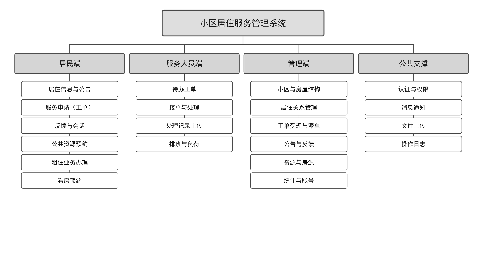

图 3-1 系统功能结构图

系统在空间维度上支持小区、楼栋、单元、房屋四级层级结构，并在此之上承载居民档案与居住关系。系统设置四类角色，其职责边界如表 3-1 所示。

表 3-1 系统角色与职责边界

| 角色 | 构成 | 职责边界 |
|------|------|---------|
| 居民 | 业主、租客、共同居住人、宿舍入住人员；已注册但尚无有效居住关系的居民 | 已建立居住关系的居民可查看居住信息与公告，提交服务申请、反馈与资源预约，参与反馈会话，确认服务结果并评价；未建立居住关系的居民仅可浏览公开公告与房源、查看可预约时段、获取联系入口并发起看房预约，不具备居住私有业务功能入口 |
| 服务人员 | 维修、保洁、客服等执行人员 | 接收并处理分配给本人的工单，更新进度，填写处理记录并上传处理结果 |
| 小区管理员 | 小区管理方人员 | 管理所绑定小区的基础信息、居住关系、工单、公告、反馈、资源、房源、居民账号与本小区统计 |
| 超级管理员 | 平台运营方人员 | 小区新建与停用、全局配置、全系统广播、管理员账号创建与小区绑定、全局统计与操作日志 |

系统边界明确排除三类内容：资金收付中的押金资金池与托管、线下垫付以及物业费与水电费缴纳；房屋买卖交易环节中的网签备案、资金监管、过户登记与税费代扣；门禁、人脸识别、摄像头等智能硬件接入。此外，系统不提供居民之间的自由社交沟通，沟通场景仅限居民与管理方之间且依托业务产生。

## 3.2 可行性分析

技术可行性方面，系统采用的 Spring Boot、Vue 3、MySQL、Redis 均为成熟且文档完备的技术，小区中有大量可参考的实现案例；项目所需的多小区数据隔离、状态机流转、预约冲突校验等功能，均可在单体架构内通过分层设计与数据库约束实现，不依赖分布式协调或专用中间件。

经济可行性方面，系统为单部署实例的单体应用，开发阶段仅需一台开发机与本地数据库、缓存服务；部署阶段可使用单台云服务器承载应用、数据库与缓存，硬件成本可控。系统不依赖付费的第三方商业接口，短信与微信服务号通道以可插拔适配接口与模拟通道实现，避免在毕业设计阶段产生持续的通道费用。

操作可行性方面，系统面向浏览器交付，用户无需安装客户端；三类入口按角色区分路由与布局，居民端以业务办理为主线组织页面，管理端以列表与详情为主，符合管理人员的操作习惯。系统同时提供接口文档作为前后端联调与后续维护的依据。

## 3.3 功能需求分析

系统功能按业务域划分为十二个模块，各模块的核心能力与验收判据在需求规格说明中逐条定义。本节按角色视角归纳功能需求，并说明关键业务的流程约束。

居民侧覆盖两类情形。未建立居住关系的居民可浏览公开公告与房源信息，按条件筛选房源，查看房源的可预约时段并获取管理方联系入口，也可发起看房预约；系统不提供匿名预约能力，看房预约须由注册并登录的居民账号发起，这一约束来自对预约责任可追溯的考虑。已建立居住关系的居民覆盖居住生活的完整链路：查看本人居住信息、房屋与租住记录；浏览公告并产生已读回执；提交服务申请（工单）并上传图片佐证，跟踪处理进度并在完成后确认与评价；提交意见建议与投诉（反馈），在管理方受理后进入会话沟通；预约公共资源并查看预约状态；对租住业务提交入住申请、租期延长申请与退租申请，在线确认租赁协议并完成缴费；预约看房并参与看房群聊。

服务人员侧聚焦工单执行：查看分配给本人的工单，接单、处理、填写处理记录并上传结果图片，更新进度至待确认。服务人员可绑定常驻小区与擅长服务类别，并按排班表体现每日班次，作为派单推荐的依据。

管理侧分为两个层级。小区管理员面向所绑定小区，负责小区与楼栋、单元、房屋的结构维护，居住关系的审核与台账管理，工单的受理与派单，公告的发布与定向广播，反馈的受理与会话，公共资源与可预约时段的配置，房源的维护与看房确认，本小区居民账号的管理以及本小区统计的查看。超级管理员面向全局，负责小区的新建、停用与级联删除，全局配置（如注册方式开关），全系统广播，管理员账号的创建与小区绑定，全局统计与操作日志的查看。

关键业务的流程约束体现在四个方面。其一，居住关系的建立分两种路径：管理员代建居民并登记关系，或居民自助注册后提交入住申请经审核通过；租赁关系还须协议双方确认且首期费用支付成功后才生效。其二，服务事项按性质分流：需要派人处理的走工单渠道，以异步流转方式全过程跟踪；需要答复沟通的走反馈渠道，以会话形式实时沟通，两条渠道共用通知与留痕机制但状态模型彼此独立。其三，预约类业务（公共资源预约与看房预约）在提交时进行时间冲突校验，同一资源或房源的重叠时段预约被拒绝。其四，所有关键数据变更与状态流转均写入操作日志，形成可追溯的记录链。

## 3.4 非功能需求分析

非功能需求从性能、安全、可靠性、可维护性与易用性五个方面提出。

性能方面，系统需在 50 并发用户下保持接口响应时间在可接受范围，单次业务请求的响应时间目标为秒级；统计报表类查询因涉及多表聚合，允许较长的响应时间但需通过缓存或预聚合控制。系统不含物联网与心跳类高频数据，业务负载稳定，单机部署即可满足。

安全方面，系统需实现基于角色的功能权限校验与按小区维度的数据权限过滤，越权访问（含小区管理员越全局级操作、跨小区数据访问）必须被拒绝并记录；用户口令以不可逆方式存储；令牌具备有效期并支持登出后失效；关键操作写入操作日志且日志保留期可配置。

可靠性方面，外部依赖（缓存、消息通道）出现故障时系统应降级而非整体不可用：缓存不可用时认证以数据库记录为权威，长连接不可用时通知以增量补拉兜底。定时任务需防止多实例重复执行，单次执行结果记入执行日志以便追溯。

可维护性方面，系统按业务域划分模块并保持分层契约，公共规则唯一维护；数据库表结构以迁移脚本为唯一事实来源，避免设计与实现出现两套口径；接口契约由代码注解生成，作为前后端联调的唯一依据。

易用性方面，三类入口按角色区分，页面以业务办理为主线组织；表单提供必要的校验提示，列表支持条件筛选与分页；关键操作提供二次确认，避免误操作。

# 4 系统设计

## 4.1 系统架构与功能模块设计

### 4.1.1 总体架构

系统采用前后端分离的单体架构，按"端—服务—数据"三层切分，部署为单个实例。浏览器端按角色加载不同的前端入口，通过 REST 接口与 WebSocket 订阅与后端交互；后端为单个 Spring Boot 应用，内部按统一接入与安全层、业务模块层、消息通知服务与横切支撑组织；数据层由 MySQL 承载业务数据、Redis 承载令牌黑名单、长连接会话注册表与缓存。

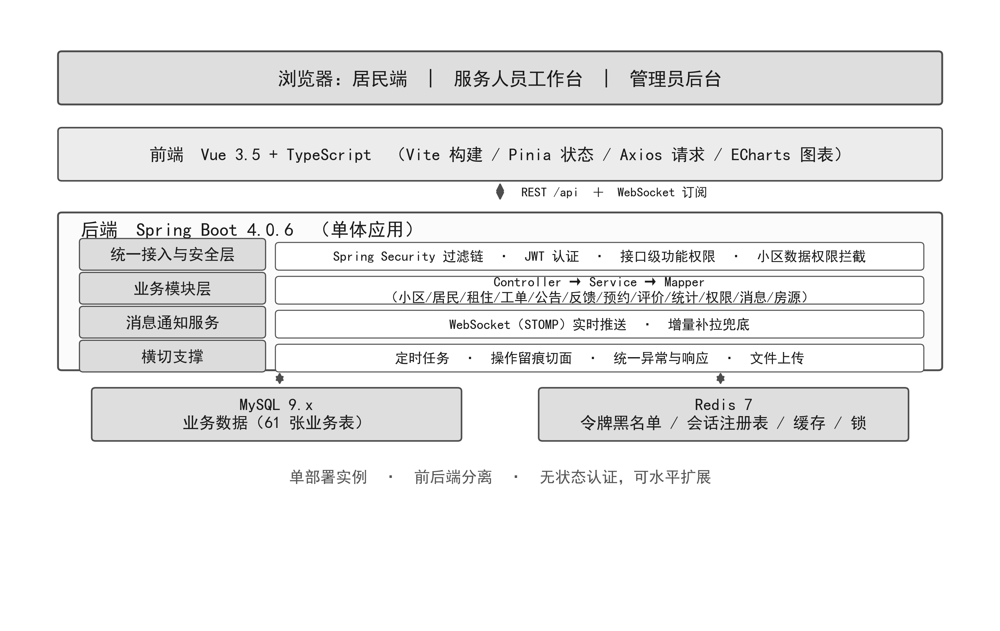

图 4-1 系统总体架构图

选择前后端分离单体而非微服务，基于三点判断。其一，系统的业务负载稳定、无高频数据，单实例即可满足并发要求，引入服务拆分只会增加部署与排障成本。其二，系统存在大量跨模块的业务协作（如租住生效同时影响房屋状态与居住关系），单体应用内以本地事务即可保证一致性，无需分布式事务。其三，毕业设计的交付目标是可运行、可验证的完整系统，单体架构的构建与部署链路更短，便于在有限时间内完成测试与部署验证。

架构上不做分布式假设，但保留扩展位：业务请求不依赖服务器会话，认证以无状态令牌实现，理论上可通过增加实例水平扩展；当前仅以单实例交付，避免为非目标场景提前付出复杂度。

### 4.1.2 功能模块划分

后端按业务域划分为十二个业务模块，并以四类分组组织代码：管理端（含超级管理员）、居民端、服务人员端与公共层。端专属的入口、协调与查询归对应端，共用实体、状态机与持久化唯一归属公共层，不复制多套规则。模块划分如表 4-1 所示。

表 4-1 系统功能模块划分

| 模块 | 职责 |
|------|------|
| 小区基础信息 | 小区、楼栋、单元、房屋、公共资源与可预约时段的维护，删除保护 |
| 居民与居住关系 | 注册开关、管理员代建、入住申请审核、居住关系台账、公开信息子集 |
| 租住管理 | 租住登记审核、状态自动判定、到期提醒、搬出归档、协议确认与缴费 |
| 服务申请与工单 | 服务类别、工单状态机、派单、处理记录时间线 |
| 公告广播 | 公告发布、定向、置顶、有效期、查看回执 |
| 居民反馈 | 反馈受理、会话消息、办结归档 |
| 公共资源预约 | 预约冲突校验、审核、违约处置 |
| 服务评价 | 工单评价、不满意跟进、按人与类别聚合 |
| 运营统计 | 运营看板聚合查询、图表数据供给 |
| 用户与权限 | 登录与令牌签发、两层权限模型、账号管理、操作日志 |
| 消息与通知 | 通知生成、长连接推送、上线补拉、渠道分级 |
| 房源与看房预约 | 房源管理、浏览统计、看房预约与群聊 |

横切模块不挂业务编号，包括技术配置、认证上下文与数据权限、统一响应与异常处理、文件上传、定时任务与操作留痕。

模块间依赖遵循三条规则：端可以依赖公共层，端与端之间不直接依赖，公共层不得反向依赖端层。控制器不得直连数据访问层，业务规则集中在服务层。

### 4.1.3 权限模型与多小区数据隔离

系统的权限分为两层：功能权限与数据权限。

功能权限解决"能不能调用某个接口"。系统以基于角色的访问控制为基础，把权限挂到接口而非页面，请求经统一的过滤器链完成身份解析后，按接口表达式判定当前角色是否具备该功能权限。之所以把受保护对象从页面改为接口，是因为前后端分离后前端路由可被绕过，只有接口层校验才具备实际约束力。

数据权限解决"能看见哪些数据"。系统支持单实例多小区，小区管理员只能操作所绑定小区的数据。若在业务代码中逐处编写小区过滤条件，既重复又易遗漏，因此系统在持久层以数据权限拦截器统一注入小区维度的过滤条件，业务代码中不出现分散的可见范围判断。超级管理员不绑定具体小区，其查询不注入小区过滤。

两层权限的组合构成系统的安全边界：功能权限拒绝越权调用，数据权限拒绝越权读取。二者相互独立，缺少任一层都会留下缺口——仅有功能权限时，小区管理员可通过合法接口读取其他小区数据；仅有数据权限时，普通居民可通过合法查询调用管理接口。

## 4.2 核心业务状态机设计

系统中的关键业务均具有明确的生命周期。若仅以枚举表达状态、在服务层各处零散判断流转条件，业务规则会随需求增加而发散。为此，系统对六类业务分别建立状态机，显式定义状态全集、合法流转路径与流转时的副作用。六类状态机的状态集合如表 4-2 所示。

表 4-2 核心业务状态机

| 业务 | 状态集合 | 说明 |
|------|---------|------|
| 工单 | 待受理、待派单、已派单、已接单、处理中、待确认、已完成、已关闭、已驳回、已取消 | 十状态，覆盖受理、派单、执行、确认与关闭全过程 |
| 租住 | 待审核、待签约、已生效、已搬出、已归档、已驳回 | 六状态；"即将到期""已到期"由租期止期自动判定，不是状态 |
| 入住申请 | 待审核、已通过、已驳回、已撤回 | 四状态，待审核阶段申请人可主动撤回 |
| 公共资源预约 | 待审核、已预约、已完成、已拒绝、已取消、已违约 | 六状态 |
| 看房预约 | 待确认、已预约、已完成、已取消、已违约 | 五状态 |
| 反馈 | 待受理、会话中、已办结 | 三状态 |

以工单为例，其状态与流转关系如图 4-2 所示。

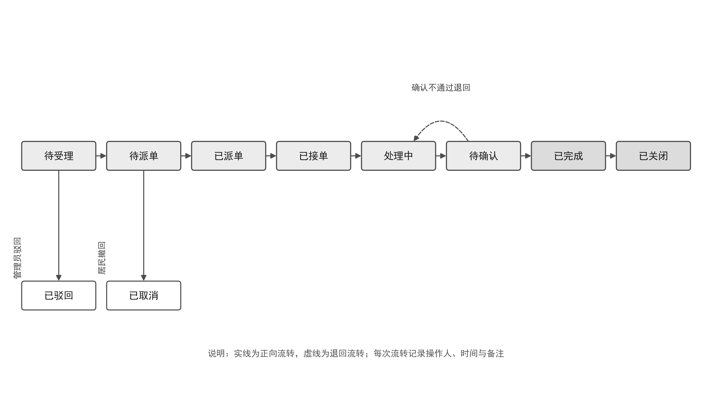

图 4-2 工单状态机流转图

状态机的设计遵循三条共同约束。第一，状态全集封闭，任何业务记录只能处于定义内的状态，不存在隐式状态。第二，流转表显式枚举合法路径，非法流转在提交前即被拒绝，而不是依赖调用方自觉。第三，每次流转同步写入处理记录，记录操作人、时间与备注，使状态变化可回溯。

以工单为例，其流转主线为：居民提交后进入待受理，管理员受理后转入待派单，派单后为已派单，服务人员接单后为已接单，开始处理后为处理中，处理完成提交后为待确认，居民确认后为已完成，最终关闭。支线包括：管理员可直接驳回不合规的申请（已驳回），居民可在受理前撤回（已取消），居民确认不通过时退回处理人继续处理。工单状态机的复杂度最高，原因是它同时承载了派单调度、执行反馈与结果确认三类参与者的动作。

租住状态机的特殊性在于其生效条件。租住记录经审核通过后并不直接生效，而是先进入待签约；协议双方确认且首期费用支付成功后，租约与正式租客的居住关系才同时生效。这一设计避免了"审核通过即占用房屋"导致的房屋状态与资金状态不一致。

## 4.3 数据库设计

### 4.3.1 设计原则

数据库设计遵循四条原则。其一，表结构以迁移脚本为唯一事实来源，设计文档与实现不保留两套口径，任何结构变更均以新增迁移脚本的方式落地。其二，命名统一采用小写单词加下划线，表名使用单数形式，主键统一为自增整数，外键字段以"表名_id"命名。其三，状态、类型等枚举值以字符串存储并在迁移脚本注释中给出取值全集，避免使用无语义的数字编码。其四，对存在并发写入风险的业务，以数据库唯一约束表达不可重复的事实，应用层的判断只作为前置拦截而不作为最终保证。

### 4.3.2 概念结构设计

系统的核心实体按业务域组织，当前共 61 张业务表，随迁移脚本 V1 至 V45 逐步建立。核心实体及其关系如下：

小区是顶层实体，向下依次为楼栋、单元、房屋四级结构，构成空间维度的骨架；公共资源挂载在小区之下，并配置可预约时段。居民是跨小区的账号实体，与房屋之间通过居住关系建立多对多联系，居住关系记录关系类型（产权人、承租人、共同居住人等）与生效区间。租住记录关联居民、小区与房屋，并派生出租约协议、缴费单、退租申请等附属实体。

服务事项分为两条链路：工单链路包含工单、处理记录、附件、派单关系，并关联服务类别与人员排班；反馈链路包含反馈单、会话消息与附件。公告包含公告主体、目标范围与查看记录三张表，以支持定向发布与已读统计。

预约类业务包含两组实体：公共资源预约与违约处置记录；房源、房源可预约时段与看房预约。两组预约共用同一套时段冲突校验逻辑，但在状态模型与处理角色上彼此独立。

权限与消息为横切实体：系统用户、管理员与小区的绑定、令牌黑名单、操作日志构成权限侧；通知记录、渠道发送记录、多方会话、会话参与者与会话消息构成消息侧。

### 4.3.3 逻辑结构设计

受篇幅限制，此处列出部分核心表的结构，其余表结构见项目数据库设计文档。

表 4-3 房屋表结构

| 字段名 | 类型 | 说明 |
|--------|------|------|
| id | bigint | 主键 |
| unit_id | bigint | 所属单元 |
| house_number | varchar | 房号，同一单元内唯一 |
| floor | int | 所在楼层 |
| area | decimal | 建筑面积 |
| layout | varchar | 户型 |
| orientation | varchar | 朝向 |
| status | varchar | 房屋状态：业主自住、租客居住、空置、维护中、停用 |
| create_time | datetime | 创建时间 |
| update_time | datetime | 更新时间 |

表 4-4 工单表结构

| 字段名 | 类型 | 说明 |
|--------|------|------|
| id | bigint | 主键 |
| community_id | bigint | 所属小区 |
| resident_id | bigint | 提交居民 |
| category_id | bigint | 服务类别 |
| title | varchar | 工单标题 |
| content | text | 问题描述 |
| status | varchar | 工单状态，十态之一 |
| assigned_staff_id | bigint | 当前处理人 |
| create_time | datetime | 提交时间 |
| finish_time | datetime | 完成时间 |

表 4-5 资源预约表结构

| 字段名 | 类型 | 说明 |
|--------|------|------|
| id | bigint | 主键 |
| resource_id | bigint | 公共资源 |
| community_id | bigint | 所属小区 |
| user_id | bigint | 预约人 |
| start_time | datetime | 开始时间 |
| end_time | datetime | 结束时间 |
| status | varchar | 预约状态，六态之一 |
| create_time | datetime | 提交时间 |

在索引与约束设计上，除各表主键外，对高频查询字段建立普通索引，包括小区标识、状态、创建时间等；对业务唯一性建立唯一约束，其中预约类业务以"资源标识加开始时间"的唯一约束表达时段占用，配合应用层的区间重叠判断，形成双重保证。外键约束按"强关联保留、弱关联以应用层维护"的原则取舍：结构类父子关系保留外键以保证完整性，业务流水类关联以索引加应用层校验维护，避免级联操作带来的意外删除。

# 5 系统实现

本章按业务模块说明关键功能的实现方式。实现遵循"分层落地、按域推进"的总体思路：后端按分层契约组织为控制器层、服务层与数据访问层，控制器层只做参数校验与响应封装，业务规则集中在服务层，数据访问层由持久层框架承担且不承载业务判断；实现顺序按业务依赖关系确定，先落地身份认证与权限，再依次实现小区基础信息、居住关系与租住、工单、公告与反馈会话、公共资源预约、房源与看房预约、消息通知中心，最后实现评价与统计。

## 5.1 用户认证与权限模块实现

### 5.1.1 认证实现

系统采用无状态令牌认证。用户提交账号与口令后，服务端校验口令哈希，签发访问令牌；令牌以 JSON Web Token 格式承载用户标识、角色与签发时间，使用对称密钥签名。此后每次请求由统一的过滤器链解析令牌、校验签名与有效期，并把身份信息放入请求上下文，业务代码不直接读取令牌。

为支持登出与强制失效，系统维护令牌黑名单：用户登出或账号被停用时，把当前令牌的标识写入黑名单并设置与令牌剩余有效期一致的过期时间，过滤器链在解析后先查黑名单。黑名单以 Redis 为主、数据库为降级方案，当缓存不可用时以数据库记录为权威，保证登出语义在缓存故障时仍然成立。

口令以加盐哈希方式存储，不保存明文，也不可逆。登录失败次数与来源受到频次限制，超限后触发拉黑并写入审计记录。

### 5.1.2 权限实现

功能权限的实现落点在接口层。系统在安全配置中按接口路径与请求方法声明所需权限，过滤器链在身份解析后逐项比对；管理员与角色的对应关系存于数据库，登录时加载并在权限变更后要求重新登录以刷新上下文。

数据权限的实现落点在持久层。系统通过持久层框架的数据权限拦截器，在生成查询语句时按当前用户可访问的小区集合追加过滤条件。拦截器从请求上下文中读取用户身份，区分超级管理员与小区管理员两类情形：超级管理员不追加小区条件；小区管理员追加"小区标识属于其绑定小区"的条件。该实现使数据隔离对所有查询路径统一生效，包括分页查询、统计聚合与导出，业务代码无需感知。

两层权限之外，系统对"本人数据"另行校验。居民只能访问本人的居住关系、租住记录与工单；服务人员只能处理分配给本人的工单。此类校验属于业务规则，放在服务层实现，与数据权限的小区过滤叠加生效。

### 5.1.3 操作日志

系统以切面方式实现操作留痕。对标注了留痕注解的服务方法，切面在方法成功返回后记录操作人、操作时间、操作对象、操作类型与变更内容，写入操作日志表。日志保留期可配置，到期由定时任务清理并通知运营者。留痕采用"成功才记录"的语义，避免失败请求污染审计链。

## 5.2 小区基础信息与居住关系模块实现

### 5.2.1 层级结构管理

小区、楼栋、单元、房屋构成四级结构。层级维护的关键约束是删除保护：已被下级节点或业务数据引用的楼栋、单元、房屋与公共资源禁止删除，只可停用。实现上，删除前逐级检查引用计数，存在引用时返回明确的拒绝原因，而非笼统的"操作失败"。

房屋具有状态属性，取值包括业主自住、租客居住、空置、维护中与停用。需要区分的是，正式居住状态由有效的主居住关系驱动，维护中与停用是人工的可用性管理，二者语义不同；房屋的挂牌意愿不等于实际入住。状态变更写入状态历史表，形成可追溯的记录。

小区支持由超级管理员级联删除，删除时下级结构与关联业务数据一并删除，操作需二次确认并全量留痕。级联删除涉及多张关联表，实现上把各业务域的清理服务纳入同一外层事务，任一环节失败则整体回滚。

### 5.2.2 居住关系管理

居住关系的建立有两条路径。路径一为管理员代建：管理员录入居民档案并创建账号，可同时登记居住关系，或仅创建账号而不登记关系。路径二为居民自助注册：居民提交入住申请，经管理员审核通过后建立关系；小区可配置自动通过，自动通过时租期按小区配置的月数推导，租金与押金取房源挂牌值。

居住关系区分主关系与依赖关系。主关系是产权人或承租人本人与房屋的关系；共同居住人以依赖关系挂靠在本房屋的有效主关系之下，不单独产生租约或付款义务。主关系结束时，依赖关系同步结束，避免出现"房屋已退租但共同居住人仍在住"的悬空数据。

关系变更（入住、搬出、租期变更）均需登记并留痕。任一房屋可查询当前居住人员与历史居住人员列表，历史记录不因关系结束而删除。

## 5.3 工单与公告反馈会话模块实现

### 5.3.1 工单实现

工单是系统中最复杂的状态机。实现上，工单状态以枚举定义，服务层集中维护合法流转表，每次流转前校验"当前状态到目标状态"是否在表中，校验通过后在同一事务内更新状态并写入处理记录。

派单环节结合人员配置给出候选推荐。系统维护服务人员与小区的常驻绑定、与服务类别的擅长绑定以及每日排班。派单时按"常驻本小区且擅长该类别"优先排序，并展示各候选人的在手工单数与当日班次，供管理员决策。派单关系单独建表，保留历次派单记录，改派不覆盖历史。

工单支持图片附件。居民提交时可上传多张图片作为问题佐证，服务人员处理完成时可上传处理结果图片。附件的访问受权限约束：居民仅可访问本人提交工单的附件，服务人员仅可访问被派单工单的附件。

### 5.3.2 公告实现

公告支持定向发布，发布时可选一个或多个小区，并可进一步限定楼栋范围。公告与目标范围分表存储，查询时按目标范围过滤，保证居民只看到与其所在小区、楼栋相关的公告。公告具有有效期与置顶标记：过期公告自动从居民端列表下线，置顶公告排在列表最前。公告查看记录用于已读统计，可计算已读人数与目标人数之比。

### 5.3.3 反馈会话实现

反馈与工单的分工在于：需要派人处理的走工单，需要答复沟通的走反馈。反馈提交后由管理员受理，受理即建立会话；会话消息通过长连接实时推送，订阅主题按会话标识划分，并在订阅时校验订阅者是否为该会话的参与者。

反馈附件独立管理，办结后禁止新增与删除，保证归档后记录不可篡改。会话消息保留发送者、发送时间与内容，办结后整体归档。

## 5.4 公共资源预约与房源看房模块实现

### 5.4.1 预约冲突校验

公共资源预约与看房预约复用同一套冲突校验逻辑。校验分两层：应用层在提交前查询同一资源或房源在目标时段内是否存在有效预约，存在则拒绝；数据库层以"资源标识加开始时间"的唯一约束兜底，防止并发提交绕过应用层判断。两层结合的原因是：应用层判断存在并发窗口，若两个请求同时通过判断，仅靠应用层会产生重复占用；唯一约束在数据库层串行化冲突写入，使最终结果唯一。

预约提交时另加分布式锁，锁的粒度为目标资源。锁的作用不是保证正确性，而是降低并发冲突导致的无效重试与事务回滚。锁的持有时间覆盖校验与写入，超时自动释放。

连续时段预约支持相邻时段合并提交：当用户选择多个相邻时段时，系统按合并后的区间进行一次冲突校验，避免逐段校验产生的边界误判。单次预约的时长上限由全局配置控制。

### 5.4.2 房源与看房预约

房源关联小区的房屋，维护位置、户型、面积、朝向、租金或售价、图片等信息，挂牌分出租与出售两类。出租房源纳入租住管理闭环；出售房源仅提供信息展示与线下看房预约，系统内不产生任何交易、网签、资金或过户记录。

看房预约须由注册并登录的居民账号发起，所选时段须落在后台配置的可预约时段内。管理方确认后，系统自动建立看房群聊，参与者包括预约居民与该小区管理员；分配带看人后，带看人加入群聊。群聊消息实时互通，越权访问被拒绝。

### 5.4.3 租住业务实现

租住记录经审核通过后进入待签约，此时房屋不置为已入住。管理方发出协议后，居民在协议正文上确认，双方确认完成且首期费用支付成功后，租约与正式租客的居住关系同时生效，房屋状态随之更新。

租赁协议采用正文快照方式留存：协议正文由模板渲染生成快照，包含双方确认人与确认时间。需要说明的是，该确认属于平台内确认留痕，不含数字证书、可信时间戳与第三方电子签服务，不主张《电子签名法》规定的可靠电子签名效力，属电子签约的工程实现简化。

缴费支持首期与续期两类支付单，通过支付渠道完成。押金具有独立状态（未缴、已缴、退还中、已退还、已抵扣），退还时由管理端发起原路退款并记录渠道结果与失败原因，以幂等键防止重复退款。平台不托管押金资金、不计息、不垫付。

## 5.5 消息通知与统计模块实现

### 5.5.1 通知实现

通知由各业务动作触发，统一写入通知表并标记接收人。站内通道采用长连接推送：前端建立连接时携带令牌完成认证，服务端按用户标识维护会话注册表，业务产生通知时向对应会话推送。为处理离线场景，系统为每个用户维护递增序号，前端上线后按本地记录的序号发起增量补拉，拉取离线期间产生的通知，保证消息不丢失且顺序正确。

推送失败或长连接不可用时，前端降级为轮询补拉，服务端的补拉接口与推送使用同一数据源，两种方式的结果一致。通知渠道分级：站内通道必达，短信与微信服务号通道由管理员按信息重要性勾选，当前以模拟通道实现并记录发送留痕。

### 5.5.2 定时任务实现

系统配置四类周期任务：租期状态自动判定、租期到期提醒、公告到期自动下线与浏览统计回写。任务之间互不阻塞，单次执行结果记入任务执行日志，包括开始时间、结束时间、处理条数与异常信息。

为防止多实例或重入导致的重复执行，任务在执行前获取分布式锁，获取失败则跳过本次执行。到期提醒另设去重表，以"租约标识加提醒类型"的唯一约束保证同一租约不重复提醒。

### 5.5.3 运营统计实现

运营统计按小区维度聚合，提供房屋状态分布、居民与入住搬出量、工单量与完成率、服务人员工作量、满意度、预约量、房源浏览与看房预约量等指标。实现上以聚合查询为主，对查询开销较大的指标采用统计快照表预聚合，快照由定时任务周期刷新。

统计结果受数据权限约束：小区管理员只能查看所绑定小区的统计，超级管理员可查看全局统计并切换小区。统计数值与库内明细数据保持一致，测试阶段以抽样核对方式验证。

## 5.6 主要界面

本节按端给出主要功能界面。界面以真实运行环境截图，数据取自演示库，仅用于说明布局与交互组织，不代表生产数据。

### 5.6.1 居民端界面

居民端首页汇总待办与公告，并在右侧提供报修、反馈、预约与房源四个快捷入口，如图 5-1 所示。待办区按业务类型聚合居民当前需要处理的事项，点击可直接进入对应业务。

图 5-1 居民端首页

工单列表按状态分组展示居民提交的工单，每条记录给出工单号、标题、当前状态与提交时间，并可进入详情查看处理进度与沟通记录，如图 5-2 所示。

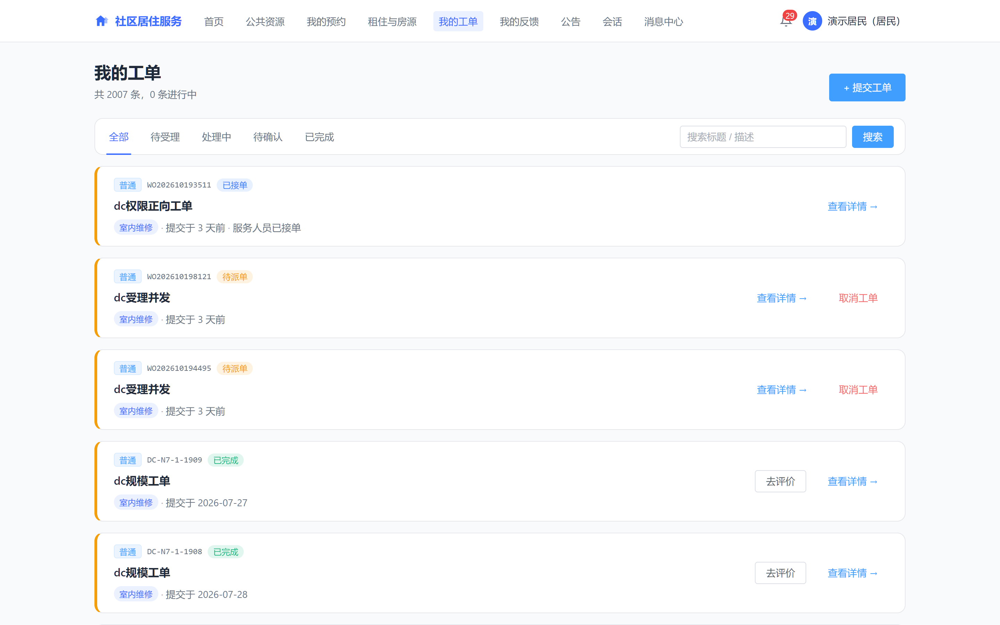

图 5-2 居民端我的工单

### 5.6.2 服务人员端界面

服务人员工单页按待接单、处理中、待确认与已完成分组，仅显示分配给本人的工单。列表给出地址、服务类别、等待时长与优先级，便于人员按紧急程度安排处理顺序，如图 5-3 所示。

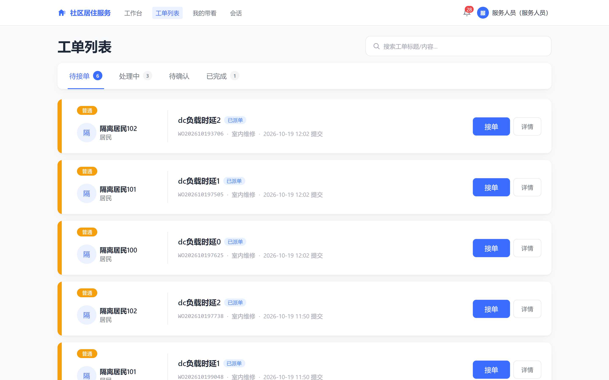

图 5-3 服务人员端工单列表

### 5.6.3 管理端界面

工单调度页以处置阶段分列展示在办工单，顶部统计各阶段数量，支持按状态、类别、紧急度与处理人筛选。卡片上标注超时情况与派单候选，管理员可直接派单或查看详情，如图 5-4 所示。

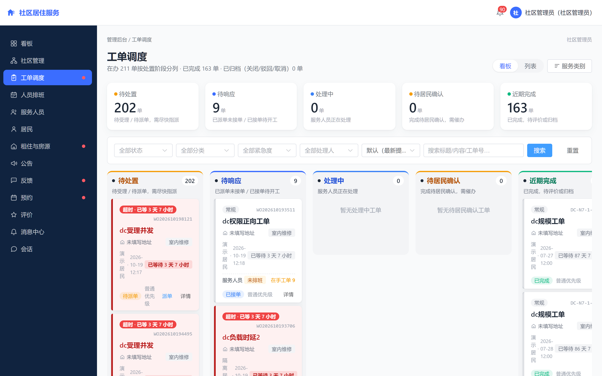

图 5-4 管理端工单调度

小区管理页以左侧小区列表配合右侧结构详情组织。结构区提供一键生成楼栋、单元与房屋的分步入口，并汇总楼栋数、单元数、房屋数与入住率；下方房屋区支持按楼栋、单元、楼层与状态筛选，如图 5-5 所示。

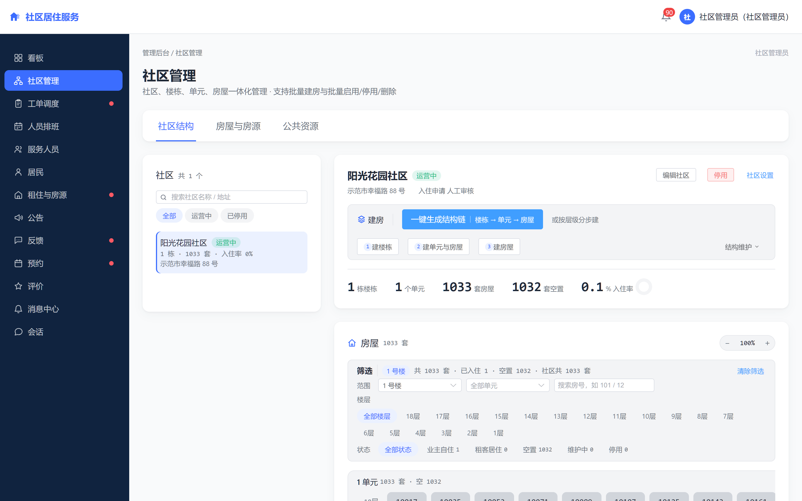

图 5-5 小区管理界面

居民管理页维护居民档案与居住关系，支持单个录入与批量导入，并展示居民与房屋的对应关系，如图 5-6 所示。

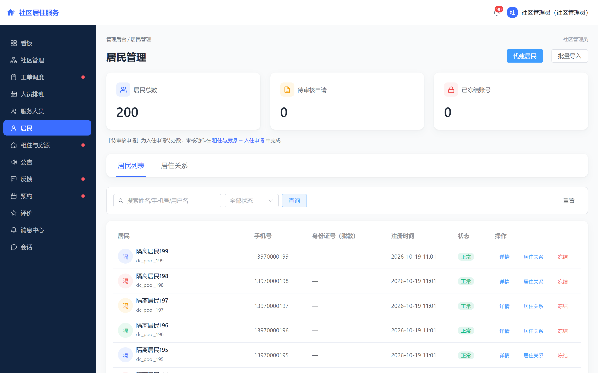

图 5-6 居民与居住关系管理

公共资源预约页按资源与时段展示预约记录，管理员可审核、拒绝或标记违约，如图 5-7 所示。

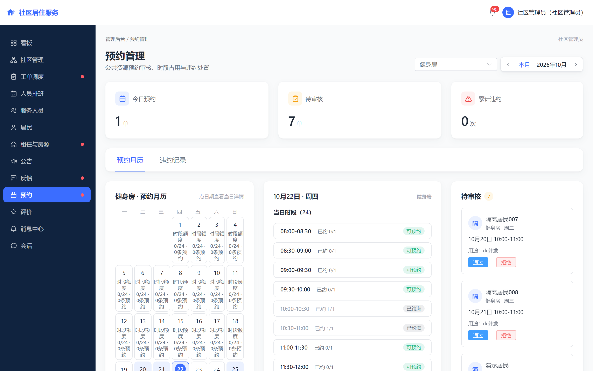

图 5-7 公共资源预约管理

租住与房源页统一管理租约属性与房源挂牌，租约详情按概览、合同与协议、费用记录、业务记录分区组织，如图 5-8 所示。

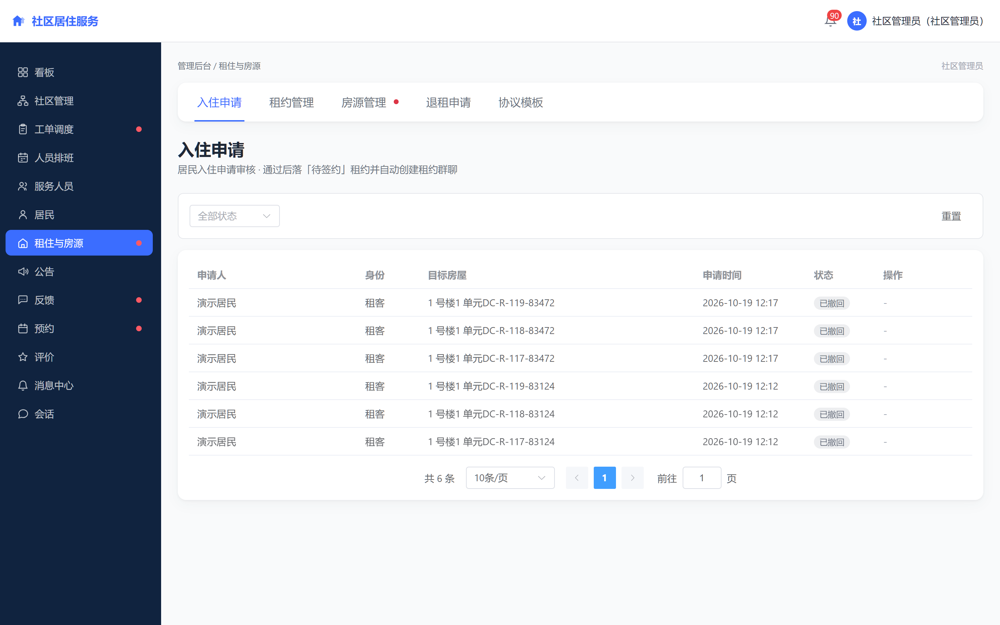

图 5-8 租住与房源管理

运营看板按所选小区与时间区间聚合指标，上方为工单量、待处理量、房屋入住率与平均评分四项概览，下方为工单、预约、看房与评价等分项指标，如图 5-9 所示。

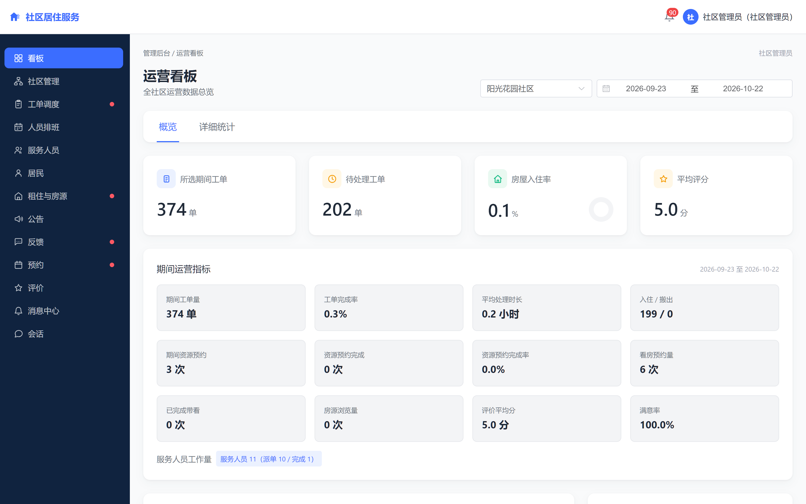

图 5-9 运营统计看板

# 6 系统测试

## 6.1 测试目的与方法

系统测试的目的是验证编码实现是否符合系统设计，即各模块的功能是否按设计预期工作、状态流转是否受约束、权限边界是否生效、异常与并发场景是否被正确处理。按照项目阶段划分，测试阶段只判断"编码是否符合设计"，"功能是否满足需求"由后续的评估验收环节判定，两者不混为一谈。

测试以需求条目为唯一来源逐条推导：每一条功能需求与非功能需求都对应可执行的测试项，测试项再细化为具体用例，形成"需求—测试项—用例—执行结果—缺陷"的完整追溯链，任何一条需求都能回答"由哪些用例验证、结果如何"。

测试过程按固定步骤推进：测试需求分析、建立需求跟踪矩阵、制定测试计划、设计用例、准备环境与数据、冒烟测试、用例执行、缺陷跟踪与回归、输出评估报告、总结归档。其中冒烟测试作为准入门槛，冒烟不通过则打回修改，不进入后续轮次，避免在基础功能不可用的状态下消耗测试资源。

测试环境分为两套。开发验证环境用于日常回归，包含应用服务、数据库与缓存服务；独立验证环境用于批次验证，使用独立数据库实例与独立端口，避免测试数据污染正常演示数据。两套环境均以迁移脚本初始化表结构，保证与交付版本一致。

## 6.2 功能测试

功能测试按业务域组织，覆盖正常流程、边界条件与异常输入三类场景。

在小区与房屋模块，用例覆盖四级结构的增删改查、删除保护（被引用的节点拒绝删除）、房屋状态变更与状态历史记录。在居民与居住关系模块，用例覆盖管理员代建与自助注册两条路径、入住申请审核、居住关系的主从依赖、主关系结束对依赖关系的联动。在租住模块，用例覆盖审核、签约、缴费、生效、延长、退租与归档的完整链路，并单独验证"协议未确认不生效""首期未支付不占用房屋"两个约束。在工单模块，用例覆盖十个状态之间的全部合法流转以及非法流转的拒绝。在公告、反馈、预约、评价与统计模块，用例分别覆盖定向发布与已读统计、会话消息实时送达与归档、预约冲突拦截与违约处置、评价唯一性与满意度聚合、统计数值与明细的一致性。

测试执行采取分层方式。后端以单元测试与集成测试为主，覆盖服务层业务规则与接口层参数校验；前端以类型检查、构建验证与组件测试为主；端到端流程以真实浏览器操作验证跨端协作。测试过程中累计执行的后端自动化测试用例达 1254 项，失败 0 项、错误 0 项，跳过 1 项（该用例依赖特定数据库环境，已在独立环境定向补跑并通过）；前端类型检查与生产构建均通过。

## 6.3 权限与冲突校验专项测试

除常规功能测试外，针对系统中风险最高的三处设计单独建立专项测试集。

第一项是权限矩阵测试。测试以否定用例为主，针对四类角色分别构造越权访问场景：居民访问管理接口、服务人员访问非本人被派单的工单、小区管理员访问其他小区数据、小区管理员执行仅超级管理员可执行的全局操作、未建立居住关系的居民访问居住私有数据。每类场景均要求请求被拒绝并留下记录。测试结果显示越权请求全部被拦截，未发现可绕过的路径。

第二项是预约时间冲突测试。测试以重叠、相邻、跨天等时段组合构造用例，验证应用层区间判断与数据库唯一约束的协同效果。重点验证并发场景：多个请求同时提交同一资源同一时段时，最终只有一条记录写入成功，其余请求收到明确的冲突提示而非系统异常。测试结果显示重叠预约全部被拦截。

第三项是多小区数据隔离测试。测试以同一角色跨小区访问为场景，验证数据权限的过滤是否在所有查询路径上生效，包括列表查询、分页查询、详情查询与统计聚合。测试结果显示跨小区数据在所有路径上均不可见。

## 6.4 测试结论

测试阶段累计发现并跟踪缺陷 223 项，按严重程度分层为：致命 8 项、严重 58 项、一般 116 项、轻微 19 项。截至测试收尾，致命与严重缺陷全部关闭，一般缺陷关闭 114 项，剩余 2 项因涉及外部支付渠道的真实资金操作，按项目既定边界保留，不作为本阶段阻塞项。

需要说明测试结论的边界。其一，测试覆盖以需求条目推导的用例集为准，自动化测试数量不等于需求覆盖率，二者不可相互替代。其二，并发与权限的验证覆盖了已识别的关键写入口与查询路径，但不构成对全部写入口的穷举证明。其三，涉及真实支付渠道的异常分支（如渠道侧退款失败的具体原因）受外部条件限制，仅验证到本地可复现的范围。

在测试之外，系统另完成部署验证：以容器编排方式在中国香港云服务器部署应用、数据库、缓存与反向代理四个服务，验证了域名访问、HTTPS、长连接通信与图片上传等关键链路。部署验证属于冒烟性质，用于确认系统可在真实服务器环境运行，不等同于生产环境的全业务验证。

# 7 总结与展望

## 7.1 工作总结

本文围绕小区管理方在房屋、居住关系、服务事项与公共资源管理中的信息分散与流程不可追溯问题，设计并实现了一个基于 Spring Boot 的小区居住服务管理系统。主要工作包括四个方面。

第一，完成了业务分析与需求建模。通过调研小区管理业务，抽象出居民、服务人员、小区管理员与超级管理员四类角色，明确了各自的职责边界与核心用例；将服务事项按性质分流为工单与反馈两条链路，并明确了系统在资金收付、房产交易与智能硬件三方面的非目标边界。

第二，完成了系统设计。采用前后端分离的单体架构，按业务域划分十二个功能模块；设计了功能权限与小区数据权限两层模型以支撑多小区场景；对工单、租住、入住申请、资源预约、看房预约与反馈六类业务建立了显式状态机，定义了状态全集与合法流转；完成了数据库的概念、逻辑与物理设计。

第三，完成了系统实现。基于 Spring Boot 与 Vue 3 实现了各业务模块，落地了无状态认证与令牌吊销、数据权限拦截器、状态机校验、预约冲突的双层校验、长连接推送与增量补拉、定时任务防重入等关键机制。

第四，完成了系统测试与部署验证。测试覆盖功能、权限、异常流程与非功能四类，越权访问与预约冲突用例全部被拦截；系统以容器化方式完成服务器部署验证。

## 7.2 不足与展望

系统仍存在若干不足。在业务覆盖上，押金资金池与托管、物业费与水电费缴纳、房屋买卖交易环节均未纳入，系统在这些环节之外提供能力。在技术实现上，租赁协议的在线确认仅为平台内留痕，未接入数字证书与可信时间戳，不构成可靠电子签名；消息通道以模拟方式实现，未对接真实的短信与微信服务。在验证范围上，并发与权限测试覆盖了已识别的关键路径，但未穷举全部写入口；涉及真实支付渠道的异常分支验证受限。

后续可从三个方向改进。其一是扩展业务闭环，在合规前提下引入资金存管与生活缴费能力，使小区服务覆盖更完整。其二是增强协议与凭证的法律效力，接入第三方电子签服务与可信时间戳。其三是提升系统的可运营性，补充多租户支持、移动端客户端与更细粒度的统计维度，使系统能够适配更广泛的管理场景。

# 参考文献

（按正文首次引用顺序排列，格式遵循 GB/T 7714-2015）

# 致谢

本课题从选题、需求分析到系统实现与论文撰写，均在指导教师的指导下完成。在系统设计与开发过程中，指导教师就业务边界的划定、状态机建模与测试方案提出了具体意见，使本人对软件工程的规范化流程有了更完整的认识。

感谢在项目推进过程中提供帮助的同学与朋友，他们在系统试用与问题反馈方面给予了支持。感谢家人一直以来的理解与鼓励。

最后，向在百忙之中评阅本文的各位老师表示诚挚的谢意。
